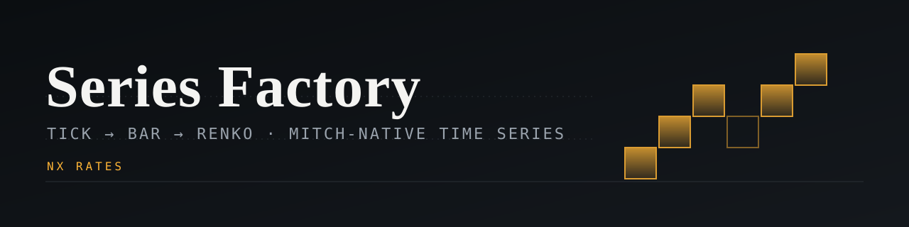

<div align="center">
  
  <h1>Series Factory</h1>
  <p>
    <strong>Historical market time-series ingestion, aggregation, and validation toolkit</strong>
  </p>
  <p>
    <a href="./LICENSE"></a>
    <a href="https://nxrates.com"></a>
    <a href="https://twitter.com/nxrates"></a>
  </p>
</div>

Rust library and CLI toolkit for building research-grade market data series from raw CEX trade archives: download, replay into composite index streams, aggregate into time and adaptive Renko bars, and certify data quality. Includes stochastic model generators (GBM, FBM, Heston, jump-diffusion) for synthetic test series.

---

## Table of Contents
- [Pipeline](#pipeline)
- [Binaries](#binaries)
- [Data Sources](#data-sources)
- [Perpetual series](#perpetual-series)
- [Synthetic Models](#synthetic-models)
- [File Formats](#file-formats)
- [Usage](#usage)
- [Renko Calibration](#renko-calibration)
- [Library Modules](#library-modules)
- [Testing](#testing)
- [Production Role](#production-role)
- [License](#license)

## Pipeline

```
CEX trade archives (ZIP/GZIP CSV)
        │  fetch-crypto-history
        ▼
raw .ticks files (per exchange, MITCH Tick)
        │  ticks-to-idx        200 ms replay of the live forwarder loop
        ▼
per-provider .idx AppendLogs (56 B IndexRecord)
        │  merge-idx           time-decay-weighted average (TDWAP) across providers
        ▼
composite daily-sharded .idx   <root>/indexes/<MITCH_ID>/<YYYY-MM-DD>.idx
        │  s10-from-idx · renko-from-idx
        ▼
daily-sharded bars             <root>/bars/<MITCH_ID>/<YYYY-MM-DD>.{s10,renko}
        │  integrity-check · glue-check · data-quality-audit
        ▼
PASS/FAIL certification
```

`backfill-all` orchestrates the full chain for many tickers in parallel, with availability probing, lazy reruns, bounded disk and a JSON report.

**Lazy, bounded, honest about degraded days.** A day is done when its composite `.idx` shard is in the manifest and on disk exactly as recorded; a partial or unlisted shard is redone, and a shard the validator condemns (`integrity-check` exit code 2) is deleted and unlisted, while any other validator outcome (killed, panicked, not spawned) leaves the shard and fails the step. Done days are never refetched or rebuilt, even when their sources are long deleted: only the runs of consecutive missing days are probed, fetched, folded and merged, and the done days between two runs are left untouched. Each run folds cold from its first missing day, so the first seconds of a run blend only the venues that have traded so far and the stored series depends slightly on the schedule of runs. `.s10` days are rebuilt only when older than their composite shard (a run of stale days is built on its own), `.renko` only when older than the composite or the calibration. A run's sources are deleted only after every merge of the run succeeded: raw `.ticks` by `backfill-all` at that point and only then (t2i keeps them), per-provider `.idx` likewise, so a failed run leaves both for the retry (`--keep-staging` keeps them always); peak disk is about one month of every venue times `--parallel`. A second backfill of a ticker already running is skipped (per-ticker lock) and its progress marker left alone.

**Venue faults and the publish lag.** The archives publish days late (OKX and Bitget cut days at UTC+8 and need the next day's file, Gate publishes a whole month, Bitget currently trails by months). `fetch-crypto-history` reports, per venue and day, whether the archive had it (`got`, `missing`, `failed`); `backfill-all` applies one policy (`PUBLISH_LAG_DAYS = 5`): a day newer than today - 5 is held (not merged, not disposed, reported as `held-days`, exit 0) while any venue in the ticker's exchange list is missing a unit for it, and it clears itself as the day ages; a day at or older than that is finalised with whatever venues have it, because a missing unit there is an archive hole or a quiet day (Bybit and Bitget write no file for a day without trades). A transport failure after retries holds its day for the run at any age (the days around it are still built) and, beyond the lag, is reported as `venue-faults` and fails the step. Which venues built each finished day is recorded in `venues.json` beside the manifest, and the report lists days finalised with fewer venues than asked (`venue-coverage`). Controls: `--exchanges` chooses the venues a ticker is held for (leave a venue out to stop waiting for it), `--rebuild --from/--to` redoes days, for example once Gate's monthly file exists for a month finalised without it. A weekly run needs a window of at least 12 days (lag 5 plus the run period 7), or days held at one run fall out of the next run's window; the lazy rerun makes the overlap free. The newest day (today) is never touched. A pair in a venue's `exclude_symbols` never enters that venue's fetch or probe.

## On-chain backfill

`onchain-backfill` rebuilds `.idx` for on-chain-only assets (MUSD, SYRUPUSDC, USDAT) from HyperSync pool logs with the live `nxr-onchain` pool/TWAP/composite math and gates, at <= 5 HyperSync req/s, default weights, records flagged `BACKFILL`.

```text
HYPERSYNC_API_KEY=... onchain-backfill --config config.yml --asset MUSD \
  --from 2026-10-17 --to 2026-11-01 --out-root <staging>      # --to strictly before today (UTC)
s10-from-idx config.yml MUSD-USD --in-dir <staging>/indexes/<id> --out-dir <staging>/bars/<id> --to-date 2026-11-01
```
Existing shards/manifest/sidecar are refused without `--force`; a leg dropped by the hold cap for >25% of the range needs `--allow-sparse`. Writes a per-asset sidecar `onchain-backfill.<ASSET>.json` (legs, held-price %, shard sha256, `weights: default`). Staging only: never a live data dir. Install by copying the new closed-day files (`*.idx`, `*.s10`) onto the PVC with tmp + rename; never overwrite a live shard.

Gap in a day the live writer already started: wait until the day is closed, then `scripts/merge_backfill_day.py <backfill.idx> <live.idx> <out.idx>` (live records kept, backfill records before the first live record prepended), rebuild that day's `.s10` with `s10-from-idx`, refresh both manifests (sha256, n_records, first/last ts), swap in with tmp + rename.

Every new symbol, leg or source needs >= 7 d of history in the rollout (`docs/internal/nxr-feeds-rollout.md`, Backfill step).

## Binaries

### Ingestion and merge

| Binary | Purpose |
|--------|---------|
| `fetch-crypto-history` | Download aggTrades/tick archives per (pair, exchange) into `.ticks` files; `--probe` mode HEAD-checks archive coverage (spot and perp) |
| `ticks-to-idx` | Replay raw `.ticks` into a per-provider `.idx` AppendLog (200 ms cycle, z-score outlier gate) |
| `merge-idx` | TDWAP-merge per-provider `.idx` files into a composite daily-sharded `.idx` directory |
| `backfill-all` | Orchestrator: fetch, ticks-to-idx, merge, s10, renko, validate; parallel tickers, lazy reruns, JSON report |
| `synth-backfill-from-idx` | Rebuild synthetic cross-pair bars (e.g. ETH-BTC) from the two leg `.idx` streams |

### Bar construction

| Binary | Purpose |
|--------|---------|
| `s10-from-idx` | Uniform 10 s OHLC bars (96 B `mitch::Bar`, full microstructure section) from composite `.idx` |
| `renko-from-idx` | Adaptive Renko bricks; brick size re-calibrated every 30 min from a Rogers-Satchell sigma `.vol` file |
| `renko-trailing-from-idx` | Walk-forward Renko backfill: per-day `k(D)` calibrated only on data before day `D` (no look-ahead) |
| `vol-from-s10` | Build an id-keyed `.vol` sigma file from persisted `.s10` shards |

### Calibration

| Binary | Purpose |
|--------|---------|
| `nxr-calibrate` | Daily offline calibration of the Renko brick multiplier per ticker (MTF binary search on a target bricks/day) |
| `window-sweep` | Walk-forward sweep answering which `rolling_window_days` minimizes bricks/day calibration error |

### Validation and maintenance

| Binary | Purpose |
|--------|---------|
| `integrity-check` | Structural validation of `.idx`, `.s10`, `.bars`, `.vol` files; CI smoke gate and post-pipeline assertion |
| `glue-check` | Seam validator for the backfill/live `.idx` join: monotonicity, cross-shard continuity, gap bounds |
| `data-quality-audit` | Per-ticker PASS/FAIL certifier: zero unexplained gaps, microstructure invariants, statistical fingerprint |
| `renko-continuity-check` | Cross-shard brick continuity, bricks/day median and MAD, s10 grid continuity |
| `live-latency-audit` | Wall-clock lag of live shard tips vs SLA budgets |
| `resample-idx` | Down-sample `.idx` shards to a coarser cadence (last-in-bucket, e.g. 100 ms to 200 ms) |
| `migrate-to-sharded` | One-time migration of flat/composite legacy layouts into the MITCH-ID daily-sharded layout |
| `heal-idx` | Repair sharded `.idx` in place: sort, resample, re-shard |

## Data Sources

One code path serves every venue and market (`sources/common.rs`); a venue file only states its archive file names, its symbol spelling and a row mapper. Spot and perp are selected by the quote (`USDT` vs `USDT:PERP`) and behave identically.

| Exchange | Spot | Perp | Monthly | Daily | Contract size |
|----------|------|------|---------|-------|---------------|
| Binance | yes | USDT/USDC (USD-M) | yes | yes | base |
| Bybit | yes | USDT/USDC (linear) | spot only | yes | base |
| OKX | yes | USDT/USDC swaps | yes | yes | contracts x `ctVal` |
| Bitget | yes | USDT/USDC | no | yes, chunked `_001..N` | base |
| Gate.io (`gateio`) | no | USDT | yes | no | contracts x `quanto_multiplier` |

Guarantees, for every row above:

- **Granularity.** Per calendar month: the monthly archive when the window covers the whole completed month (or the venue has no daily archive), otherwise daily archives; a monthly that is missing, failed or empty falls back to daily. A window inside a month never downloads the month.
- **Missing vs failed.** 404 and 403 mean the archive has no such object: final, quiet. Every other failure (and a download shorter than its `Content-Length`) is retried 3 times with backoff and then logged as a warning. A zero-tick download is never kept. A completed month that yields nothing is warned about.
- **Caching.** A non-empty `.ticks` file is never fetched again; files are written atomically, so a torn download is never mistaken for a cache hit. The contract-size lookup (OKX, Gate.io) happens only when something is actually downloaded.
- **Windows.** OKX and Bitget cut their days and months at UTC+8: a day's file starts at 16:00 UTC the day before. The fetch therefore also takes the day after the window, and `ticks-to-idx --from-date/--to-date` folds exactly the UTC window (`backfill-all` passes it), so every venue covers the same UTC days. Bitget stamps whole seconds; `ticks-to-idx` spreads trades sharing a stamp evenly over that second in file order (carrying a run across chunk and file boundaries), else the venue leads real time by up to a second.
- **Rows.** Header, short and unparseable rows are skipped. A row with a non-finite or non-positive price, or a non-finite or negative size, is dropped. The side is the taker's side. Quote volume is `price x size x contract size`, rounded to whole quote units, at least 1 and saturating at `u32::MAX`. Output is ascending in time (a newest-first file is reversed).
- **Probe.** `fetch-crypto-history --probe` HEAD-checks the same archive units a fetch would use, newest then oldest first, and reports first and last archive date; a long window is sampled at an even stride. A transport fault is reported as unknown, never as no coverage.

Archive URLs are `stem + file name`. The stem is config (`cexs.exchanges.<name>.archive_url_template.{monthly,daily}` for spot, `.perp.{monthly,daily}` for perps); the file name is the venue's layout. Sources convert each trade to a tick with bid = ask = the trade price and the size on the taker's side (flagged `NO_BOOK`: no order book is ever invented). The composite is a smoothed fair value of executed prices across venues, not a tradable tape.

**No public bulk trade history** (probed on 2026-11-11, unauthenticated; re-probe before relying on it): Hyperliquid (requester-pays S3), Aster, MEXC, XT.com, WhiteBIT (login-gated downloads), CoinW (also hard-excluded from index construction), Toobit, Ourbit, Lighter (account-scoped export, REST only), Variational (per-user CSV only). Only REST recent-trades or vendor-paid history exists for these, so no fetcher is provided.

## Perpetual series

A perp series is the same pipeline with the quote spelled `USDT:PERP` (or `USDC:PERP`), the SDK's `BASE/QUOTE:PERP` convention. The MITCH ticker id then carries the PERP instrument type, so spot and perp of one pair never share an id, a raw-tick directory (`ticks/<exchange>/BTCUSDT:PERP/`), a per-provider `.idx` (`indexes/<exchange>/BTC-USDT:PERP.idx`) or a composite directory (`indexes/<MITCH_ID>/`). `merge-idx` blends several perp venues exactly as it does spot, with the same `cexs.exchanges.<name>.weight`.

Backfill (fetch, per-provider idx, merge, s10, renko, validate):

```bash
backfill-all config.yml --tickers BTC-USDT:PERP,ETH-USDT:PERP --exchanges binance,bybit,okx,bitget,gateio \
  --from 2026-10-01 --to 2026-10-31
```

or stage by stage:

```bash
fetch-crypto-history config.yml --pairs BTC --exchanges binance,bybit,okx,bitget,gateio --quote USDT:PERP --days 30
for x in binance bybit okx bitget gateio; do ticks-to-idx $x BTC USDT:PERP; done
merge-idx BTC USDT:PERP --exchange binance --exchange bybit --exchange okx --exchange bitget --exchange gateio
s10-from-idx config.yml BTC-USDT:PERP
```

Notes:
- `backfill-all` needs explicit `--tickers`: the default pair set includes stablecoin bases that have no perps. `gateio` is perp-only and not in the default exchange list; add it explicitly.
- The availability probe runs for perps as for spot: a venue with no such contract is dropped with a warning, and a perp ticker no venue covers is skipped, never re-sourced from Pyth (Pyth history is spot-only). Without the probe (`--skip-probe`) a venue with no contract fails its fetch and the ticker continues on the others.
- Perp volume per day is several times spot's: the disk guard scales its per-day estimate accordingly.
- The raw-tick directory and `.idx` file names contain a colon.
- Contract-sized venues (OKX, Gate.io) convert contracts to base units with the multiplier read from the venue's public instrument endpoint at fetch time; a historical change of that multiplier is not reflected.
- A trade smaller than one quote unit carries one unit of volume, as for spot.
- Perp provider ids in `.idx` headers are the spot venue's ids (the series is told apart by ticker id and path, not by provider id).
- Contracts quoted per 1000 units (e.g. Binance `1000PEPEUSDT`) are not rescaled.
- `merge-idx` requires a weight for every exchange (`cexs.exchanges.<name>.weight` in the config or `--weight name=n`) and fails naming the venue otherwise; relay providers are exempt.
- Gate.io publishes complete months only: a window that ends in the current month has nothing from it, and a window inside a completed month downloads the whole month (the raw `.ticks` then hold the full month).
- Funding, mark and index prices are not part of any trade archive and are not ingested.

## Synthetic Models

The `sources::synthetic` module implements `TickSource` for five stochastic processes (500 ms tick epoch, parameters annualized):

| Model | Parameters |
|-------|------------|
| Geometric Brownian Motion | `mu, sigma, base` |
| Fractional Brownian Motion | `mu, sigma, hurst, base` |
| Heston stochastic volatility | `mu, sigma, kappa, theta, xi, rho, base` |
| Normal jump-diffusion (Merton) | `mu, sigma, lambda, mu_jump, sigma_jump, base` |
| Double-exponential jump-diffusion (Kou) | `mu, sigma, lambda, mu_pos_jump, mu_neg_jump, p_neg_jump, base` |

Construct via the library: `create_source(&DataSource::Synthetic(GenerativeModel::GBM { mu, sigma, base }))`. Each synthetic instance gets a distinct provider id, so multiple synthetic sources feed the aggregator as independent providers.

## File Formats

All on-disk types are MITCH protocol structs: `#[repr(C, packed)]`, `bytemuck::Pod`, read via mmap and zero-copy cast. Timestamps are MITCH `mts`, a 6-byte u48 LE counting 16 microsecond ticks since 2010-01-01 UTC.

| Extension | Record | Size | Content |
|-----------|--------|------|---------|
| `.ticks` | `mitch::TickFrame` | 48 B | 16 B MITCH header + 32 B tick: timestamp, bid, ask, vbid, vask |
| `.idx` | `IndexRecord` | 56 B | composite index: mid, confidence, volumes, flags |
| `.s10` | `mitch::Bar` | 96 B | 10 s OHLC kline, 64 B OHLCV + 32 B microstructure |
| `.renko` | `mitch::Bar` | 96 B | adaptive Renko brick, same layout |
| `.vol` | `VolRecord` | 14 B | (mts, Rogers-Satchell sigma) per 30-min bin, EMA-smoothed |

Per-bar microstructure section: realized variance, bipower variance (jump-robust, Barndorff-Nielsen and Shephard 2004), OLS drift, signed volume imbalance (OFI), average spread in bps, max absolute return, quality metadata.

Sharded layout (single source of truth in `nxr_sdk::shard`):

```
<root>/indexes/<MITCH_ID>/<YYYY-MM-DD>.idx
<root>/bars/<MITCH_ID>/<YYYY-MM-DD>.{s10,renko}   + manifest.json
```

Files are append-only streams with no file-level header (each `.ticks` record embeds its own 16 B MITCH header); record count = file size / record size from the table above.

## Usage

Build (requires the sibling `mitch` and `sdk` checkouts of the parent nx-rates repository, referenced as path dependencies):

```bash
cargo build --release
```

Fetch one year of BTC and ETH history from two exchanges:

```bash
fetch-crypto-history config.yml --pairs BTC,ETH --exchanges binance,bybit --days 365
```

Replay raw ticks into a per-provider index, then merge providers into a composite:

```bash
ticks-to-idx binance BTC USDT --cycle-ms 200 --z 6.0
merge-idx BTC USDT --exchange binance --exchange bybit --weight binance=40 --weight bybit=30
```

Build bars from the composite:

```bash
s10-from-idx config.yml BTC-USDT
renko-from-idx config.yml BTC USDT
```

Or run the whole chain for a ticker set:

```bash
backfill-all config.yml --tickers BTC-USDT,ETH-USDT --from 2024-01-01
```

Validate:

```bash
integrity-check dir /data --parallel 4
glue-check --all --data-root /data
data-quality-audit --data-root /data --json
```

Paths default to the standard environment (`$NXR_DATA_TICKS`, `$NXR_DATA_INDEXES`, `$NXR_DATA_BARS`); every offline binary accepts explicit overrides.

## Renko Calibration

Adaptive Renko brick size is `price * clamp(m * sigma_blend, b_min, b_max)`, where `sigma_blend` is the EMA-smoothed Rogers-Satchell sigma over 30-min OHLC bins built from gapless `.s10` bars. The multiplier `m` is calibrated per ticker against a target brick density (bricks/day, default 300) by direct binary search (`scale_to_target_k`).

Two calibration regimes:

- `nxr-calibrate`: daily cron; fits `m` on a trailing window, writes `ticker-params.json` atomically.
- `renko-trailing-from-idx`: historical backfill; re-fits `k(D)` for every UTC day `D` using only data with `ts < D_start`, so backtests on the output contain no look-ahead. Calibration granularity matches apply granularity (full ticks, not downsampled), which matters: a 1-min downsample biases `k` 3-5x small.

`window-sweep` selects the rolling window length empirically by walk-forward error rather than judgment.

## Library Modules

- `sources/`: exchange archive downloaders (Binance, Bybit, OKX, Bitget, Gate.io) + synthetic generators, all behind the `TickSource` trait.
- `bar_construction/`: `.vol` builder (Rogers-Satchell sigma over s10 OHLC) and Renko multiplier calibration (`scale_to_target_k`).
- `sharding.rs`: thin re-export of the canonical `nxr_sdk::shard` daily-shard primitives.
- `seam.rs`: cross-shard continuity invariants shared by tests and checker binaries.
- `idx_heal.rs`: in-place `.idx` repair (sort, resample, re-shard).
- `vol_bin.rs`: zero-copy `.vol` mmap reader/writer.
- `types.rs`: config plus re-exports of `mitch::TickFrame` and `mitch::bar::Bar`.

Streaming Renko engine, sigma blending, OHLC rollup, and TDWAP live in the shared `nxr-sdk` crate; this repo holds the offline tooling.

## Testing

```bash
cargo test
```

Integration tests cover seam continuity between offline and live shards (`seam_joint_offline_live`), sentinel-aware gap handling (`seam_sentinel_skip`), integrity-check smoke (`integrity_smoke`), and a bricks/day acceptance gate (`bpd_acceptance`, `--ignored`, requires real shards; asserts the per-ticker median is within 15% of target).

## Production Role

These binaries run in the NX Rates pipeline: `backfill-all` and the checkers run as Kubernetes Jobs/CronJobs against the live data volume, `nxr-calibrate` refreshes Renko multipliers daily, and the bar-construction code paths are byte-for-byte identical to the live s10/renko producers, so offline history and the live stream join without seams. Offline defaults (200 ms cycle, z-gate 6.0, TDWAP weights) deliberately mirror the live aggregator configuration.

## License

MIT. See [LICENSE](LICENSE).
